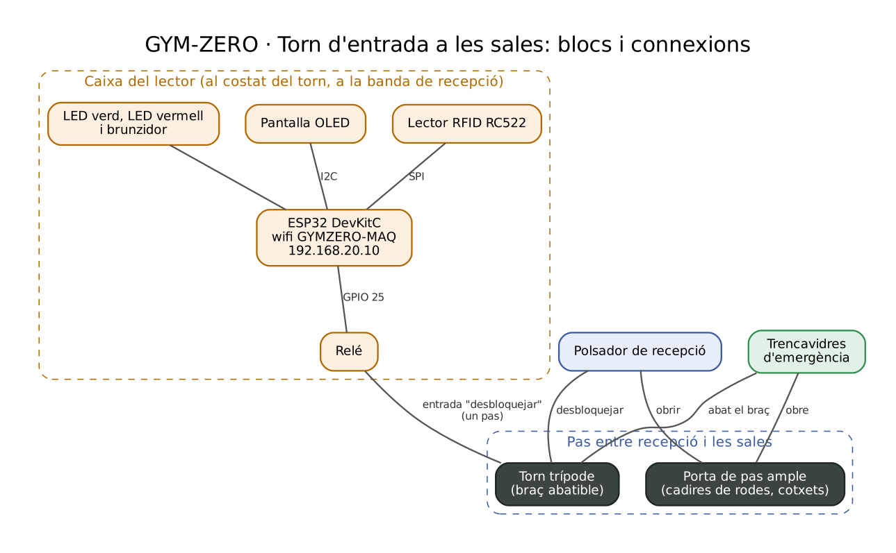
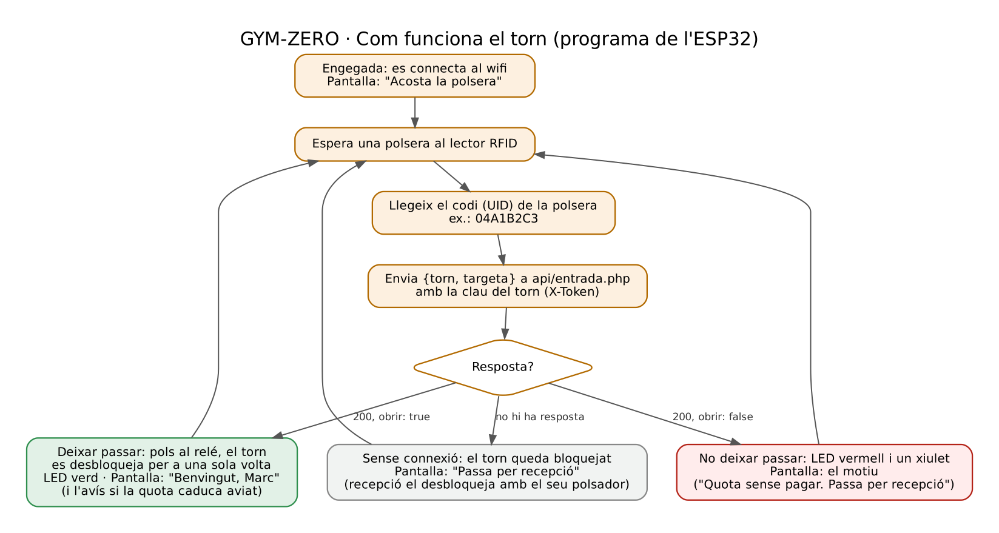

# GYM-ZERO · Control d'accés amb la polsera

**Estat:** el torn i el seu lector estan **dissenyats, no construïts**. La part de la web sí que està programada i provada a XAMPP: la base de dades, l'API (`api/entrada.php`), la quota a la pàgina *Usuaris*, la pàgina *Entrades* del panell i el simulador del torn (`simulador/torn.cpp`).

## 1. Com s'entra al gimnàs

1. **Porta del carrer: lliure.** Durant l'horari està oberta i qualsevol pot arribar a recepció: un client que ha de pagar, algú que es vol apuntar o una visita. Fora d'horari es tanca amb clau.
2. **Torn entre recepció i les sales: amb la polsera.** Per passar a la sala de força, al cardio, a la sala de classes i als vestidors, el client acosta la polsera al lector del torn. Si té la quota pagada, el torn es desbloqueja per a una volta.
3. **Sortir és lliure.** El torn gira sense polsera en el sentit de sortida.

Així, un client amb la quota caducada entra sol fins a recepció, paga, i en el moment que li donen **+1 mes** ja pot passar el torn.

## 2. Qui pot passar el torn

| Cas | Passa? | Pantalla |
|---|---|---|
| Client amb la quota pagada | Sí | Benvingut, Marc |
| Client amb la quota pagada que caduca en 7 dies o menys | Sí | Benvingut, Pau · La quota caduca el 25/10 |
| Client amb la quota caducada o sense pagar mai | No | Quota sense pagar. Passa per recepció |
| Compte desactivat | No | Compte desactivat. Passa per recepció |
| Polsera que no és de ningú | No | Polsera desconeguda. Passa per recepció |
| Administrador (personal del gimnàs) | Sí, sempre | Hola, Admin |

**La quota.** Cada client té a la base de dades l'últim dia que té la quota pagada (`usuaris.quota_fins`). Quan paga a recepció, l'administrador prem **+1 mes** a la pàgina *Usuaris* i la data avança un mes. Si ja havia caducat, el mes compta des d'avui. El cobrament en si (efectiu o targeta al taulell) no el fa la web.

## 3. Diagrama de blocs



## 4. Peces

| Peça | Model | Per a què serveix | Preu orientatiu |
|---|---|---|---|
| Torn | Torn trípode d'acer inoxidable, 12 V, amb braç abatible i entrada de contacte per desbloquejar | Deixa passar una persona cada vegada | 650 € |
| Porta de pas ample | Porta batent de 90 cm, que es controla des de recepció | Pas per a cadires de rodes, cotxets i per entrar material | 350 € |
| Microcontrolador | ESP32 DevKitC | Llegeix la polsera, pregunta a l'API i desbloqueja el torn | 10 € |
| Lector RFID | RC522 (13,56 MHz) | Llegeix el codi (UID) de la polsera | 3 € |
| Pantalla | OLED 0,96" SSD1306 | Mostra "Benvingut" o el motiu | 5 € |
| Relé | Mòdul de relé de 5 V, 1 canal | Fa el contacte que desbloqueja el torn | 3 € |
| Polsador de recepció | Polsador amb cable fins al taulell | Deixar passar algú sense polsera i obrir la porta ampla | 8 € |
| Trencavidres | Polsador d'emergència verd | En una emergència, abat el braç del torn i obre la porta ampla | 10 € |
| LEDs i brunzidor | LED verd, LED vermell, brunzidor | Avisar si pot passar o no | 2 € |
| Caixa, font i cables | Caixa de plàstic, font de 5 V | Protegir i alimentar l'electrònica | 15 € |
| **Total** | | | **≈ 1.056 €** |

Els preus són orientatius. No s'ha comprat res.

## 5. Connexions a l'ESP32

El lector RFID i la pantalla van connectats igual que a la màquina intel·ligent (vegeu `maquina/disseny-maquina.md`), així el programa comparteix la mateixa base.

| Peça | Pota de l'ESP32 |
|---|---|
| RC522 (SPI): SDA, SCK, MOSI, MISO, RST | GPIO 5, 18, 23, 19, 4 |
| Pantalla OLED (I2C): SDA, SCL | GPIO 21, 22 |
| Relé | GPIO 25 |
| LED verd / LED vermell | GPIO 26 / GPIO 27 (amb resistència de 220 Ω) |
| Brunzidor | GPIO 14 |

El relé no porta corrent al torn: només tanca un contacte mig segon a l'entrada "desbloquejar" del torn, com si algú premés un botó. El polsador de recepció va connectat a la mateixa entrada.

## 6. Seguretat de les persones

- **Sortir sempre és possible**, encara que l'ESP32 s'hagi penjat o no hi hagi Internet: el torn gira lliure en el sentit de sortida.
- **Si se'n va la llum o es prem el trencavidres**, el braç del torn cau i la porta ampla s'obre. El pas queda lliure.
- **La porta del carrer no té cap lector.** No pot deixar ningú tancat a dins.

## 7. Funcionament



## 8. Dades que envia (format JSON)

```
POST https://gymzero.cat/api/entrada.php
Content-Type: application/json
X-Token: <clau del torn>

{"torn": "TORN-01", "targeta": "04A1B2C3"}
```

Resposta quan la petició és correcta (codi 200), deixi passar o no:

```
{"ok": true, "obrir": true, "usuari": "Pau", "missatge": "Benvingut, Pau", "avis": "La quota caduca el 25/10"}
{"ok": true, "obrir": false, "usuari": "Laia", "missatge": "Quota sense pagar. Passa per recepció", "avis": ""}
```

| Codi | Quan |
|---|---|
| 200 | Petició correcta. `obrir` diu si el torn es desbloqueja |
| 400 | El JSON està mal format |
| 401 | El torn no existeix o la clau no és correcta |
| 403 | El torn està donat de baixa |
| 405 | No és un POST |
| 422 | El codi de la polsera no té entre 8 i 20 xifres hexadecimals |

Cada intent que arriba a l'API queda apuntat a la taula `entrades`: qui, quan, si ha passat i per què. L'administrador ho veu a la pàgina *Entrades* del panell.

## 9. Xarxa

El lector del torn va per wifi, com les màquines: xarxa GYMZERO-MAQ (VLAN 20), IP 192.168.20.10, a través de l'AP 1, que és el de recepció. Té les mateixes regles del tallafoc que les màquines: només pot parlar amb gymzero.cat per HTTPS. Vegeu `xarxa/disseny-xarxa.md`.

## 10. Seguretat de les dades

- **Clau pròpia del torn** a la capçalera `X-Token`, guardada amb hash a la taula `torns`, igual que les màquines.
- **El lector no sap res dels clients.** Només llegeix el codi de la polsera; qui és i si ha pagat ho decideix el servidor.
- **Polsera perduda:** a recepció se li canvia el codi i l'antiga deixa de servir.
- **Lector robat o espatllat:** l'administrador el dona de baixa a la base de dades i l'API deixa d'acceptar-lo (codi 403).

## 11. Simulador

`simulador/torn.cpp` fa el paper del lector del torn: s'hi escriu el codi de la polsera, envia la mateixa petició que enviaria el lector real i ensenya si el torn es desbloqueja.

```
g++ -std=c++17 -Wall -o torn torn.cpp
./torn http://localhost/gymzero/api/entrada.php TORN-01 token-TORN-01
```

Les proves de l'API són a `proves/acces.sh`, i el resultat a `proves/acces_resultat.txt`.

## 12. Limitacions

- **Sense Internet el torn no es desbloqueja amb la polsera**, perquè el lector no pot saber si la quota està pagada. Recepció el desbloqueja amb el seu polsador. Una millora seria que el lector guardés la llista de polseres vàlides i la fes servir quan no hi ha connexió.
- **Només es controla l'entrada a les sales.** Per sortir no cal la polsera, així que no se sap quanta gent hi ha a dins en cada moment.
- **El torn és la part cara** (≈ 1.000 € amb la porta ampla). Una porta normal amb pany elèctric costaria molt menys, però una polsera podria deixar passar dues persones alhora.
- No s'ha provat cap peça.
