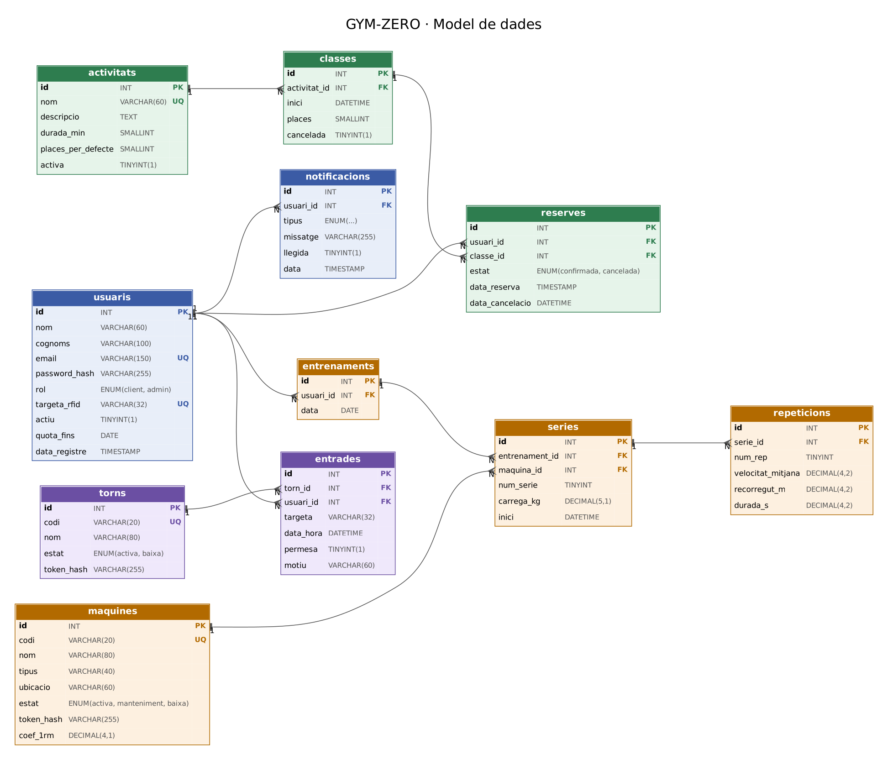

# GYM-ZERO · Disseny de la base de dades (Fase 2)

Estat: **dissenyada i provada en local** (MariaDB 10.11). Encara no està a Dinahosting.

Fitxers:
- `gymzero_bd.sql`: crea les 11 taules i la vista.
- `actualitza_fase9.sql`: afegeix la quota i les taules del torn a una base de dades que ja existeix, sense esborrar res.
- `dades_prova.sql`: usuaris, classes, reserves i entrenaments d'exemple.
- `diagrama-bd.png` / `diagrama-bd.svg`: diagrama entitat-relació.
- `proves/prova_concurrencia.php` i `proves/resultat_prova.txt`: prova del límit de places.



## 1. Taules

| Taula | Què guarda | Servei |
|---|---|---|
| `usuaris` | Clients i administradors. Rol `client` o `admin`. Codi de la polsera i fins quan té pagada la quota (`quota_fins`). | Usuaris i login |
| `activitats` | Tipus d'activitat: Musculació, Cross Training, etc. | Reserves |
| `classes` | Una activitat en un dia i hora concrets, amb un nombre de places. | Reserves |
| `reserves` | Quin usuari ha reservat a quina classe i si està confirmada o cancel·lada. | Reserves |
| `maquines` | Les màquines intel·ligents (codi, tipus, estat) i el número de la fórmula del 1RM de cada exercici (`coef_1rm`). | Màquines |
| `entrenaments` | El dia que un usuari entrena. Agrupa les sèries d'aquell dia. | Màquines i historial |
| `series` | Una sèrie en una màquina: càrrega i número de sèrie. | Màquines i historial |
| `repeticions` | Cada repetició que envia la màquina: velocitat, recorregut i durada. | Màquines i anàlisi |
| `notificacions` | Avisos per a l'usuari (reserva confirmada, classe cancel·lada...). | Notificacions |
| `torns` | Els torns d'accés amb lector de polsera (codi, estat i clau de l'API). | Control d'accés |
| `entrades` | Cada vegada que algú acosta la polsera al torn: qui, quan, si ha passat i per què. | Control d'accés |

A més, la vista `v_resum_series` calcula el resum de cada sèrie: repeticions, velocitat mitjana, velocitat màxima i **pèrdua de velocitat** (de la repetició més ràpida a l'última). És el que farà servir l'historial del client.

## 2. Relacions

- Un usuari té moltes reserves, molts entrenaments i moltes notificacions (1:N).
- Una activitat té moltes classes; una classe té moltes reserves (1:N).
- Usuaris i classes queden relacionats N:M a través de `reserves`.
- Un entrenament té moltes sèries; una sèrie té moltes repeticions (1:N).
- Una màquina té moltes sèries (1:N).
- Un torn i un usuari tenen moltes entrades (1:N). Si la polsera no és de ningú, l'entrada es guarda sense usuari.

## 3. Decisions i per què

**Activitat ≠ classe.** Abans la reserva guardava el nom de l'activitat com a text i una data i hora qualsevol. Ara el client reserva una `classe` que existeix, amb unes places concretes. Sense això no es pot controlar l'aforament.

**Sense reserves duplicades.** La clau única `(usuari_id, classe_id)` fa que la base de dades rebutgi que un usuari reservi dues vegades la mateixa classe. Si cancel·la, la reserva no s'esborra: passa a `cancelada`, i si torna a reservar es torna a confirmar la mateixa fila.

**Límit de places amb concurrència.** Si dues persones reserven l'última plaça al mateix moment, totes dues poden veure "queda 1 plaça" i totes dues entren. Per evitar-ho, la reserva es fa dins d'una transacció i es bloqueja la fila de la classe:

```sql
START TRANSACTION;
SELECT places FROM classes WHERE id = ? AND cancelada = 0 FOR UPDATE;  -- bloqueja la classe
SELECT COUNT(*) FROM reserves WHERE classe_id = ? AND estat = 'confirmada';
-- si queden places:
INSERT INTO reserves (usuari_id, classe_id) VALUES (?, ?)
  ON DUPLICATE KEY UPDATE estat = 'confirmada', data_cancelacio = NULL;
COMMIT;   -- (o ROLLBACK si no queden places)
```

Mentre una reserva no fa `COMMIT`, les altres de la mateixa classe s'esperen al `FOR UPDATE`. Resultat de la prova (`proves/resultat_prova.txt`), amb 3 usuaris reservant alhora una classe de 2 places on ja n'hi havia 1 d'ocupada:

| | Reserves finals | Places |
|---|---|---|
| Sense `FOR UPDATE` | 4 | 2 |
| Amb `FOR UPDATE` | 2 | 2 |

**Contrasenyes.** Es guarda `password_hash`, mai la contrasenya. A PHP es fa amb `password_hash()` i es comprova amb `password_verify()`.

**Polsera RFID.** Cada usuari pot tenir el codi (UID) d'una polsera, a la columna `targeta_rfid`. La màquina i el torn l'envien per saber qui és. Al projecte la polsera és **simulada**: els simuladors envien aquest codi.

**Repeticions per separat.** Guardant cada repetició es pot calcular la pèrdua de velocitat dins d'una sèrie i comparar sessions. Són càlculs simples sobre dades guardades; no es fa cap diagnòstic.

**Un entrenament per usuari i dia.** Quan arriba la primera sèrie del dia, l'API crea l'entrenament; les següents s'hi afegeixen.

**Clau de cada màquina.** Cada màquina (o el simulador) s'identifica a l'API amb un token. A la base de dades només es guarda el hash, igual que les contrasenyes.

**1RM diferent a cada màquina.** Amb el mateix pes i les mateixes repeticions, el pes màxim (1RM) no és igual en tots els exercicis. Per això cada màquina guarda el seu número de la fórmula (`coef_1rm`):

`1RM = pes × (1 + repeticions / coef_1rm)`

És la fórmula d'Epley, que fa servir 30 per a tots els exercicis. Els números de cada màquina surten de les taules de Nuzzo et al. (2023, *Sports Medicine*), que recullen quantes repeticions fa la gent al 70% i al 80% del seu màxim: al press de banca en fan una mica menys (34) que a la majoria d'exercicis (35), i a la premsa de cames moltes més (48). Per al rem no hi ha dades pròpies i es fa servir el general. Si cal, el número de cada màquina es pot canviar a la base de dades.

**Quota i entrades.** La quota és una data (`quota_fins`), no una taula de pagaments: la web només ha de saber si avui la té pagada. Les entrades es guarden també quan el torn no deixa passar, per saber qui ho ha intentat i per què. Si s'esborra un usuari, les seves entrades es queden sense usuari (`ON DELETE SET NULL`) en lloc d'esborrar-se.

**Còpies de seguretat.** No són una taula: es faran amb `mysqldump` des del servidor (ho veurem a la fase de backups).

## 4. Com provar-ho a XAMPP

1. Arrenca XAMPP: `sudo /opt/lampp/lampp start`.
2. Obre `http://localhost/phpmyadmin` i crea una base de dades `gymzero_db` (cotejament `utf8mb4_unicode_ci`).
3. Selecciona-la > **Importar** > `gymzero_bd.sql`.
4. Torna a **Importar** > `dades_prova.sql`.
5. Comprova-ho a la pestanya SQL: `SELECT * FROM v_resum_series;`

Usuaris de prova: `admin@gymzero.cat` / `Admin1234` i `marc@example.com` / `Client1234`.

**No ho importis a Dinahosting encara.** El fitxer esborra l'antiga taula `reserves` i el formulari que funciona ara a la web antiga deixaria de funcionar. Es pujarà quan el PHP nou (Fase 3) estigui fet.
