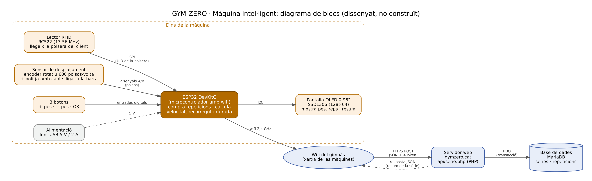
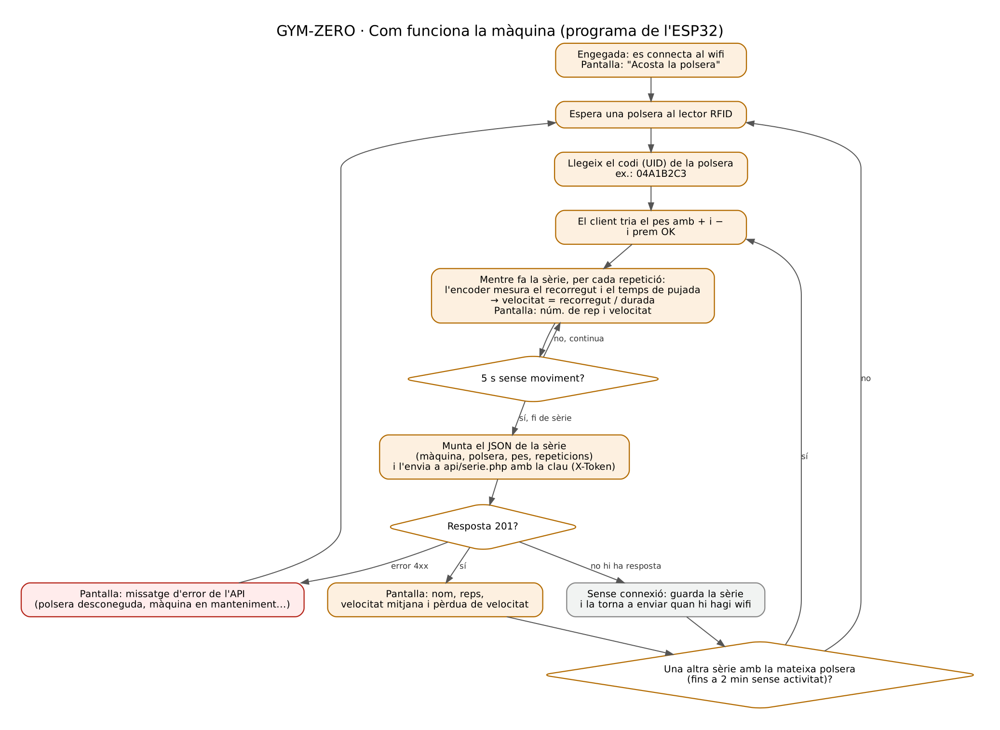

# GYM-ZERO · Disseny de la màquina intel·ligent

**Estat: dissenyada, no construïda.** No s'ha comprat ni muntat cap peça. Les dades que enviaria la màquina les genera el simulador (`simulador/simulador.cpp`), que fa servir el mateix format i la mateixa API que faria servir la màquina real.

## 1. Què ha de fer

Una màquina de força normal (press de banca, rack de sentadilla, rem) amb una petita caixa electrònica que:

1. Sap qui entrena, perquè el client hi acosta la seva polsera RFID.
2. Sap quin pes hi ha, perquè el client el tria amb dos botons.
3. Mesura cada repetició: quant recorre la barra, quant triga a pujar i a quina velocitat.
4. Quan s'acaba la sèrie, l'envia al servidor de GYM-ZERO, que la guarda a la base de dades.
5. Ensenya a la pantalla el resum que torna el servidor.

## 2. Diagrama de blocs



## 3. Peces

| Peça | Model | Per a què serveix | Preu orientatiu |
|---|---|---|---|
| Microcontrolador | ESP32 DevKitC (ESP32-WROOM-32) | Llegeix els sensors, compta les repeticions i envia les dades per wifi | 10 € |
| Lector RFID | RC522 (13,56 MHz) | Llegeix el codi (UID) de la polsera del client | 3 € |
| Polseres | Polsera de silicona amb xip MIFARE Classic 1K (una per client) | Identifica el client; no cal treure-la per entrenar i aguanta la suor | 1,5 € cada una |
| Sensor de desplaçament | Encoder rotatiu de 600 polsos per volta | Mesura quant es mou la barra | 15 € |
| Politja i cable retràctil | Politja de 5 cm amb cable d'acer i molla | El cable va lligat a la barra; quan la barra puja, la politja gira | 8 € |
| Pantalla | OLED 0,96" SSD1306 (128×64) | Mostra el pes, les repeticions i el resum | 5 € |
| Botons | 3 polsadors (+, −, OK) | Triar el pes i començar la sèrie | 3 € |
| Alimentació | Font USB de 5 V i 2 A | Dona corrent a tot | 8 € |
| Caixa i cables | Caixa de plàstic, cables Dupont | Protegir l'electrònica | 7 € |
| **Total per màquina** (sense les polseres) | | | **≈ 59 €** |

A més, a recepció cal un lector RFID USB (uns 12 €, un per a tot el gimnàs). Quan s'hi acosta una polsera, escriu el codi com si fos un teclat; així l'administrador l'assigna al client des de la pàgina *Usuaris* del panell d'administració, que sí que està programada.

Els preus són orientatius, de botigues d'electrònica en línia. No s'ha comprat res.

## 4. Connexions a l'ESP32

| Peça | Pota de la peça | Pota de l'ESP32 |
|---|---|---|
| RC522 (bus SPI) | SDA (SS) | GPIO 5 |
| | SCK | GPIO 18 |
| | MOSI | GPIO 23 |
| | MISO | GPIO 19 |
| | RST | GPIO 4 |
| | 3.3V / GND | 3V3 / GND |
| Pantalla OLED (bus I2C) | SDA | GPIO 21 |
| | SCL | GPIO 22 |
| | VCC / GND | 3V3 / GND |
| Encoder | Senyal A | GPIO 32 |
| | Senyal B | GPIO 33 |
| | VCC / GND | 5V / GND |
| Botons | + / − / OK | GPIO 25 / 26 / 27 (l'altra pota a GND) |

Les sortides de l'encoder són de col·lector obert: es connecten amb resistències de *pull-up* a 3,3 V perquè no arribin mai 5 V a l'ESP32. Els botons fan servir el *pull-up* intern de l'ESP32.

## 5. Com mesura les repeticions

El cable de la politja va lligat a la barra (o a la placa de dalt de la pila de pesos, a la màquina de rem). Quan la barra es mou, la politja gira i l'encoder envia polsos:

- Politja de 5 cm de diàmetre: una volta són 15,7 cm de cable.
- L'encoder dona 600 polsos per volta. Comptant els flancs dels dos senyals (A i B), en surten 2.400 per volta, és a dir, un pols cada 0,07 mm.
- El sentit de gir (qui arriba primer, A o B) diu si la barra puja o baixa.

L'ESP32 té un comptador de polsos per hardware (PCNT), així no se'n perd cap encara que el programa estigui fent una altra cosa.

**Una repetició** és una pujada de més de 10 cm. Quan la barra comença a pujar es guarda la posició i l'hora; quan para o torna a baixar, es calcula:

- `recorregut` = posició final − posició inicial (en metres)
- `durada` = hora final − hora inicial (en segons)
- `velocitat` = recorregut / durada (velocitat mitjana de la pujada, en m/s)

Si en 5 segons no hi ha cap moviment, la sèrie s'ha acabat.

## 6. Funcionament



## 7. Dades que envia (format JSON)

En acabar cada sèrie, la màquina fa una petició a l'API de la web:

```
POST https://gymzero.cat/api/serie.php
Content-Type: application/json
X-Token: <clau de la màquina>

{
  "maquina": "PRESS-01",
  "targeta": "04A1B2C3",
  "carrega_kg": 62.5,
  "repeticions": [
    {"velocitat": 0.77, "recorregut": 0.41, "durada": 0.52},
    {"velocitat": 0.74, "recorregut": 0.42, "durada": 0.57}
  ]
}
```

El camp de la polsera es diu `targeta` a l'API i `targeta_rfid` a la base de dades: guarda el codi del xip RFID, que és igual en una targeta que en una polsera.

| Camp | Què és | Valors acceptats |
|---|---|---|
| `maquina` | Codi de la màquina | Ha d'existir a la taula `maquines` |
| `targeta` | UID del xip de la polsera del client | Ha de ser d'un usuari actiu |
| `carrega_kg` | Pes de la sèrie | 0 a 500 kg |
| `repeticions` | Llista de repeticions, en ordre | 1 a 50 |
| `velocitat` | Velocitat mitjana de la pujada | 0,01 a 5 m/s |
| `recorregut` | Distància que puja la barra | 0,01 a 3 m |
| `durada` | Temps que triga a pujar | 0,05 a 20 s |

L'API respon sempre en JSON:

| Codi | Quan | Què ensenya la pantalla |
|---|---|---|
| 201 | Sèrie guardada | Nom del client, número de sèrie, velocitat mitjana i pèrdua de velocitat |
| 400 | El JSON està mal format | Error de dades |
| 401 | La màquina o la clau no són correctes | Màquina no autoritzada |
| 403 | La màquina està en manteniment o de baixa | Màquina fora de servei |
| 404 | La polsera no és de cap client actiu | Polsera desconeguda |
| 422 | Algun valor està fora de límits (sensor espatllat) | Error del sensor |

Exemple de resposta correcta:

```
{"ok": true, "usuari": "Marc", "serie_id": 11, "num_serie": 1, "repeticions": 2,
 "velocitat_mitjana": 0.76, "perdua_velocitat_pct": 3.9}
```

## 8. Seguretat

- **Cada màquina té la seva clau.** Va a la capçalera `X-Token`. A la base de dades només se'n guarda el hash, com les contrasenyes dels usuaris.
- **HTTPS.** Les dades van xifrades entre la màquina i el servidor.
- **La màquina no guarda dades personals.** Només coneix el codi de la polsera; el nom el torna el servidor.
- **Si un client perd la polsera**, a recepció se li canvia el codi i l'antiga deixa de funcionar.
- **Si una màquina s'espatlla o la roben**, l'administrador la posa en manteniment o de baixa i l'API deixa d'acceptar-ne dades (codi 403).
- **Sense wifi** no es perd la sèrie: la màquina la guarda i la torna a enviar quan torna la connexió.

## 9. Màquina real i simulador

| | Màquina real (dissenyada) | Simulador (fet) |
|---|---|---|
| Qui entrena | Polsera i lector RFID | S'escriu el codi de la polsera |
| Pes | Botons + i − | S'escriu el pes |
| Repeticions | Encoder i politja | Les inventa amb un model: com més pes, més lenta, i cada repetició perd un 2-5% de velocitat |
| Enviament | Wifi, HTTPS POST | `curl`, HTTP POST |
| Format i API | El de l'apartat 7 | El mateix |
| Llenguatge | C++ (Arduino per a ESP32) | C++ |

Com que el format i l'API són els mateixos, si un dia es construeix la màquina no caldria canviar res de la web ni de la base de dades.

## 10. Limitacions

- La velocitat només es mesura en un eix (amunt i avall). Si la barra es mou de costat, el cable s'inclina i la mesura és una mica més gran.
- Si el client no tria bé el pes amb els botons, la sèrie es guarda amb el pes equivocat.
- No s'ha provat cap peça. Els valors (10 cm per comptar una repetició, 5 s per acabar la sèrie) caldria ajustar-los amb la màquina de veritat.
