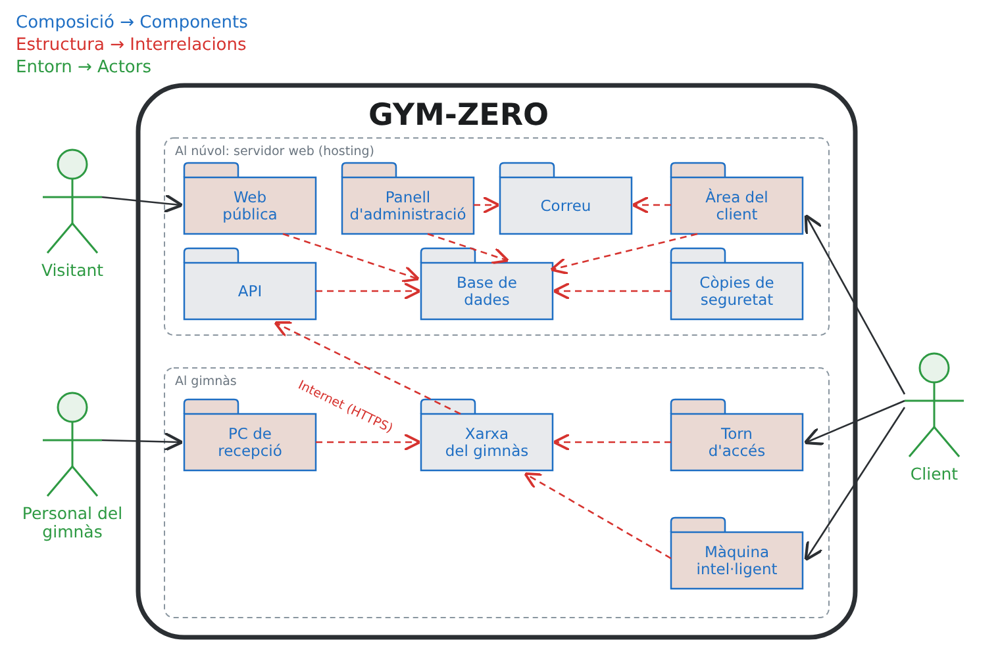

# GYM-ZERO · Definició del sistema

GYM-ZERO digitalitza un gimnàs que funcionava amb paper i telèfon. El sistema té una part al núvol (la web i la base de dades) i una part al gimnàs (la xarxa, el torn de l'entrada i les màquines).

## Composició

Els components del sistema:

| Component | Tipus | Què fa |
|---|---|---|
| Web pública | Software | Ensenya l'horari, les activitats i els càlculs (1RM, IMC, calories) |
| Àrea del client | Software | El client hi reserva classes i mira els seus entrenaments |
| Panell d'administració | Software | El personal hi gestiona classes, clients, quotes i polseres |
| API | Software | Rep les dades de les màquines i del torn |
| Base de dades | Software | Guarda els usuaris, les classes, les reserves i les sèries |
| Correu | Software | Envia el correu per recuperar la contrasenya |
| Còpies de seguretat | Software | Fa còpies de la base de dades |
| Servidor web | Núvol | On funcionen la web, l'API i la base de dades |
| Router | Hardware | Connecta el gimnàs a Internet i fa de tallafocs |
| Switch | Hardware | Connecta per cable el PC, el torn i la wifi |
| Wifi | Hardware | Connecta les màquines, el personal i els clients |
| PC de recepció | Hardware | Des d'on treballa el personal; guarda una còpia de la base de dades |
| Torn d'accés | Hardware | Llegeix la polsera a l'entrada i obre si la quota està pagada |
| Màquina intel·ligent | Hardware | Llegeix la polsera i envia cada sèrie (pes i repeticions) |
| Polsera RFID | Hardware | La porta cada client per identificar-se |

Al diagrama, el router, el switch i la wifi surten junts com a «Xarxa del gimnàs».

## Estructura

Com es relacionen els components:

- La web pública, l'àrea del client, el panell i l'API llegeixen i guarden les dades a la **base de dades**.
- L'àrea del client fa servir el **correu** quan algú ha oblidat la contrasenya.
- El **torn** i la **màquina** envien les dades per la xarxa del gimnàs i Internet fins a l'**API**.
- Les **còpies de seguretat** es fan de la base de dades, i el **PC de recepció** se les baixa.

Hi ha components **interns**, que ningú fa servir directament: la base de dades, l'API, les còpies i la xarxa.
I n'hi ha d'**externs**, que fan servir les persones: la web pública, l'àrea del client, el panell, el PC de recepció, el torn i la màquina.

## Entorn

Els actors que fan servir el sistema:

| Actor | Què fa | Amb quins components |
|---|---|---|
| Visitant | Mira l'horari, les activitats i els càlculs | Web pública |
| Client | Reserva classes, entra amb la polsera, entrena i mira el seu progrés | Àrea del client, torn, màquina |
| Personal del gimnàs | Dona d'alta clients, cobra quotes i fa el seguiment (recepció i entrenador) | Panell d'administració, PC de recepció |
