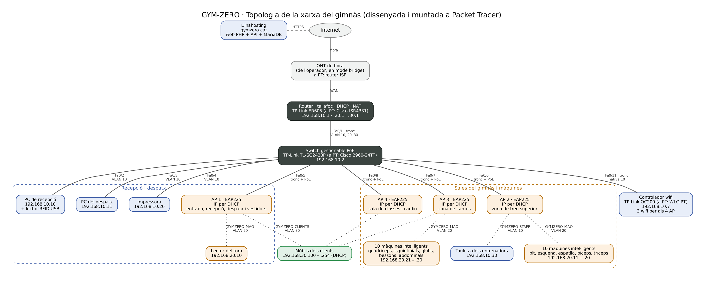
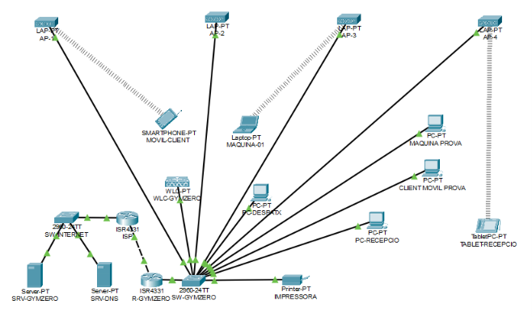

# GYM-ZERO · Disseny de la xarxa del gimnàs

**Estat: dissenyada i muntada a Packet Tracer** ([packet-tracer/gymzero-xarxa.pkt](packet-tracer/gymzero-xarxa.pkt)). El gimnàs és fictici i no s'ha comprat cap equip. La web, l'API i la base de dades sí que existeixen i són al hosting (gymzero.cat).

## 1. Què ha de connectar

| Qui | Què fa a la xarxa |
|---|---|
| PC de recepció | Rebre els clients, donar d'alta comptes, assignar polseres amb el lector RFID USB, mirar les reserves del dia |
| PC del despatx | Gestió del gimnàs: classes, activitats, usuaris i màquines. Separat de recepció perquè la gestió no es faci al taulell on s'atén el públic |
| Impressora | Imprimir horaris, rebuts i fulls d'inscripció (des dels dos PCs) |
| Tauleta dels entrenadors | A la sala de força, per mirar l'historial d'un client mentre l'entrena |
| Màquines intel·ligents (20) | Envien cada sèrie a l'API de gymzero.cat per HTTPS |
| Torn d'entrada a les sales | Pregunta a l'API de gymzero.cat si una polsera pot passar |
| Mòbils dels clients | Wifi per als clients: reservar classes i mirar el seu entrenament |

Els PCs i la tauleta fan servir la mateixa web que els clients, amb un compte d'administrador. No cal cap programa instal·lat a part del navegador.

**No hi ha cap servidor al gimnàs.** La web, l'API i la base de dades són a Dinahosting. Així el gimnàs no ha de mantenir cap servidor, i la web funciona igual des de casa que des del gimnàs. A dins només calen la xarxa i els equips que s'hi connecten.

## 2. Topologia

Les línies contínues són cable (Ethernet) i les de punts, wifi.

Així és com ha quedat muntada a Packet Tracer:

## 3. Equips

| Equip | Model | Per a què | Preu orientatiu | A Packet Tracer |
|---|---|---|---|---|
| ONT de fibra | La de l'operador | Connexió a Internet | (de l'operador) | Router ISP (ISR4331) |
| Router i tallafoc | TP-Link ER605 | Separa les xarxes (VLAN), fa de DHCP, fa el NAT i decideix qui pot parlar amb qui | 60 € | Cisco ISR4331 (R-GYMZERO) |
| Switch | TP-Link TL-SG2428P (24 ports, gestionable, PoE) | Connecta els equips i dona corrent als punts d'accés pel mateix cable | 300 € | Cisco 2960-24TT (SW-GYMZERO) |
| Controlador wifi | TP-Link OC200 | Configura els quatre punts d'accés des d'un sol lloc: les xarxes wifi, les contrasenyes i la VLAN de cada una | 90 € | WLC-PT (WLC-GYMZERO) |
| Punts d'accés wifi (4) | TP-Link EAP225 | Un a recepció, dos a la sala de força (20 màquines repartides en dues zones) i un a la sala de classes | 4 × 70 € | LAP-PT (AP-1 a AP-4) |
| PCs (2) | PC de sobretaula senzill amb Ubuntu | Recepció i despatx | 2 × 450 € | PC-PT |
| Impressora | Multifunció làser amb xarxa | Imprimir i escanejar | 150 € | Printer-PT |
| Tauleta | Tauleta Android de 10" | Entrenadors a la sala | 180 € | TabletPC-PT |
| Lector RFID USB | Lector 13,56 MHz que fa de teclat | Llegir el codi de les polseres | 12 € | (no n'hi ha) |
| Armari, cables i preses | Cable de categoria 6 | Instal·lació | 80 € | |
| **Total** | | | **≈ 2.050 €** | |

A més, 20 màquines intel·ligents a uns 59 € d'electrònica cadascuna (vegeu el disseny de la màquina): ≈ 1.180 €. I el torn d'entrada a les sales amb la porta de pas ample (vegeu el disseny del control d'accés): ≈ 1.056 €.

Els preus són orientatius. No s'ha comprat res. Els equips de Packet Tracer són Cisco perquè és el que porta el programa, però fan el mateix que els del disseny.

## 4. Xarxes separades (VLAN)

Cada tipus d'equip va en una xarxa diferent. Si un mòbil d'un client té un virus, no pot arribar ni al PC de recepció ni a les màquines.

| VLAN | Nom | Xarxa | Porta d'enllaç | Qui hi ha |
|---|---|---|---|---|
| 10 | Gestió | 192.168.10.0/24 | 192.168.10.1 | Router, switch, controlador wifi, punts d'accés, PCs, impressora i tauleta |
| 20 | Màquines | 192.168.20.0/24 | 192.168.20.1 | Les màquines intel·ligents i el lector del torn |
| 30 | Clients | 192.168.30.0/24 | 192.168.30.1 | Mòbils dels clients |

El router té una subinterfície per a cada VLAN (G0/0/0.10, .20 i .30) pel mateix cable que va al switch.

## 5. Adreces IP

| Equip | IP | Com |
|---|---|---|
| Router (VLAN 10 / 20 / 30) | 192.168.10.1 / 192.168.20.1 / 192.168.30.1 | Fixa |
| Switch | 192.168.10.2 | Fixa |
| Controlador wifi | 192.168.10.7 | Fixa |
| PC de recepció | 192.168.10.10 | Fixa |
| PC del despatx | 192.168.10.11 | Fixa |
| Impressora | 192.168.10.20 | Fixa |
| Tauleta dels entrenadors | 192.168.10.30 | Fixa |
| Punts d'accés (4) | 192.168.10.100 en endavant | DHCP |
| Lector del torn d'entrada a les sales | 192.168.20.10 | Reserva DHCP (per MAC) |
| Màquines intel·ligents | 192.168.20.11 a 192.168.20.30 (taula de sota) | Reserva DHCP (per MAC) |
| Lliures per a més màquines | 192.168.20.31 a 192.168.20.99 | |
| Mòbils dels clients | 192.168.30.100 a 192.168.30.254 | DHCP |

El DHCP és al router. A Gestió i Clients reparteix a partir de la .100, i a Màquines a partir de la .10. Les adreces de sota estan excloses perquè són per als equips amb IP fixa.

Els punts d'accés no necessiten IP fixa. El DHCP de la VLAN 10 els diu on és el controlador (opció 43, `192.168.10.7`) i el controlador els configura sols.

El lector i les màquines tenen sempre la mateixa IP perquè, si una falla, a la llista del router es veu de seguida quina és.

### Màquines intel·ligents

Dues per cada grup muscular. Totes 20 són a la base de dades de proves (`bd/dades_prova.sql`), amb la clau de prova `token-<CODI>`, i es poden fer servir amb el simulador. PRESS-01, SQUAT-01 i REM-01 mantenen el codi que tenien.

| Grup muscular | Codi | Màquina | IP | AP |
|---|---|---|---|---|
| Pit | PRESS-01 | Press de banca | 192.168.20.11 | 2 |
| Pit | CONTR-01 | Contractora de pit | 192.168.20.12 | 2 |
| Esquena | REM-01 | Rem assegut | 192.168.20.13 | 2 |
| Esquena | JALO-01 | Jaló al pit | 192.168.20.14 | 2 |
| Espatlla | MILITAR-01 | Press militar en màquina | 192.168.20.15 | 2 |
| Espatlla | LATERAL-01 | Elevacions laterals en màquina | 192.168.20.16 | 2 |
| Bíceps | CURL-01 | Curl de bíceps en màquina | 192.168.20.17 | 2 |
| Bíceps | CURLP-01 | Curl de bíceps en politja | 192.168.20.18 | 2 |
| Tríceps | TRICEP-01 | Extensió de tríceps en màquina | 192.168.20.19 | 2 |
| Tríceps | FONS-01 | Fons en màquina | 192.168.20.20 | 2 |
| Quàdriceps | SQUAT-01 | Rack de sentadilla | 192.168.20.21 | 3 |
| Quàdriceps | EXTQ-01 | Extensió de quàdriceps | 192.168.20.22 | 3 |
| Isquiotibials | FEMS-01 | Curl femoral assegut | 192.168.20.23 | 3 |
| Isquiotibials | FEME-01 | Curl femoral estirat | 192.168.20.24 | 3 |
| Glutis | HIP-01 | Hip thrust en màquina | 192.168.20.25 | 3 |
| Glutis | ABDUC-01 | Abductora | 192.168.20.26 | 3 |
| Bessons | TALOD-01 | Elevació de talons dempeus | 192.168.20.27 | 3 |
| Bessons | TALOA-01 | Elevació de talons asseguda | 192.168.20.28 | 3 |
| Abdominals | CRUNCH-01 | Crunch en màquina | 192.168.20.29 | 3 |
| Abdominals | ROTA-01 | Rotació de tronc | 192.168.20.30 | 3 |

## 6. Xarxes wifi

Les tres xarxes es configuren al controlador i les emeten els quatre punts d'accés.

| Nom (SSID) | VLAN | Seguretat | Notes |
|---|---|---|---|
| GYMZERO-MAQ | 20 | WPA2-PSK amb AES, contrasenya llarga que només té l'administrador | Només 2,4 GHz (l'ESP32 no fa servir 5 GHz) |
| GYMZERO-STAFF | 10 | WPA2-PSK amb AES, contrasenya del personal | Per a la tauleta dels entrenadors |
| GYMZERO-CLIENTS | 30 | WPA2-PSK amb AES, contrasenya penjada a recepció | Aïllament de clients: un mòbil no veu els altres. Límit de 10 Mbps per mòbil |

Els PCs i la impressora van per cable.

Cada punt d'accés posa a cada dispositiu l'etiqueta de la VLAN de la seva wifi i l'envia pel cable fins al switch (al controlador, *local switching*). Per això els ports dels punts d'accés són troncals. El trànsit del mateix punt d'accés, el que fa servir per parlar amb el controlador, va sense etiqueta per la VLAN 10.

### On va cada punt d'accés

Els AP van al sostre. La posició surt de la maqueta 3D del gimnàs (`gimnas/`), comptant que cada AP cobreix uns 11 m al voltant. Amb aquesta posició no queda cap racó sense wifi.

| AP | On és | Cobreix |
|---|---|---|
| AP 1 | Sobre el taulell de recepció | Entrada, recepció, despatx, vestidors i part del cardio |
| AP 2 | Sala de força, entre les màquines de pit i d'esquena | Tren superior i vestidor 1 |
| AP 3 | Sala de força, entre les màquines de glutis i de bessons | Cames, abdominals i pes lliure |
| AP 4 | Al mig de la sala de classes | Sala de classes, cardio i pes lliure |

## 7. Ports del switch

| Port | Connectat a | Mode |
|---|---|---|
| Fa0/1 | Router | Tronc: VLAN 10, 20 i 30 |
| Fa0/2 | PC de recepció | Accés: VLAN 10 |
| Fa0/3 | PC del despatx | Accés: VLAN 10 |
| Fa0/4 | Impressora | Accés: VLAN 10 |
| Fa0/5 | AP 1 (recepció) | Tronc: VLAN 10, 20 i 30, nativa 10, amb PoE |
| Fa0/6 | AP 2 (tren superior) | Tronc: VLAN 10, 20 i 30, nativa 10, amb PoE |
| Fa0/7 | AP 3 (cames) | Tronc: VLAN 10, 20 i 30, nativa 10, amb PoE |
| Fa0/8 | AP 4 (sala de classes) | Tronc: VLAN 10, 20 i 30, nativa 10, amb PoE |
| Fa0/9 | Port de proves de Màquines | Accés: VLAN 20 |
| Fa0/10 | Port de proves de Clients | Accés: VLAN 30 |
| Fa0/11 | Controlador wifi | Tronc: VLAN 10, 20 i 30, nativa 10 |
| Fa0/12 a Fa0/24, Gi0/1 i Gi0/2 | Res | Apagats |

Els ports 9 i 10 serveixen per connectar un portàtil per cable i comprovar que una VLAN funciona sense haver de passar per la wifi.

## 8. Regles del tallafoc

El router només deixa passar el que cal. Tot el que no és a la taula està prohibit.

| Des de | Cap a | Permès |
|---|---|---|
| Gestió (10) | Internet | Tot |
| Gestió (10) | Màquines (20) | Sí, per comprovar si una màquina respon |
| Màquines (20), també el lector del torn | Internet | Només HTTPS (port 443) a gymzero.cat, i DNS (53) i hora (NTP, 123) al servidor DNS |
| Màquines (20) | Gestió (10) i Clients (30) | No |
| Clients (30) | Internet | Web (80, 443) i DNS (53) |
| Clients (30) | Gestió (10) i Màquines (20) | No |
| Internet | Qualsevol VLAN | No (només les respostes del que s'ha demanat des de dins) |

Al router són tres llistes d'accés (ACL), cada una aplicada a l'entrada d'una interfície:

| ACL | On s'aplica | Què fa |
|---|---|---|
| MAQUINES-IN | G0/0/0.20 (Màquines) | Deixa passar el DHCP, el DNS i l'hora cap al servidor DNS, l'HTTPS cap a gymzero.cat i les respostes cap a Gestió. Res més |
| 130 | G0/0/0.30 (Clients) | Deixa passar el DHCP, bloqueja Gestió i Màquines, deixa passar DNS, web i HTTPS. Res més |
| INTERNET-IN | G0/0/1 (Internet) | Només deixa entrar les respostes: connexions TCP ja establertes, respostes de DNS i d'hora i respostes de ping |

Gestió no té ACL perquè pot anar a tot arreu.

La sortida a Internet és amb NAT (PAT). Tots els equips surten amb l'única IP pública del router i el router els distingeix pel port.

## 9. Com viatja una sèrie

1. El client acaba una sèrie a PRESS-01 (192.168.20.11).
2. La màquina envia el JSON per la wifi GYMZERO-MAQ a l'AP 2.
3. L'AP 2 el passa al switch etiquetat amb la VLAN 20, i el switch el passa al router.
4. El router comprova que és HTTPS cap a gymzero.cat (permès), hi aplica NAT i l'envia a Internet.
5. El servidor de Dinahosting (`api/serie.php`) la guarda a la base de dades i respon.
6. La resposta fa el camí al revés fins a la pantalla de la màquina.

## 10. Seguretat

- Les tres xarxes estan separades i el tallafoc no deixa passar d'una a l'altra.
- Les màquines només poden parlar amb gymzero.cat. Encara que algú n'obrís una, no podria fer servir la connexió per a res més.
- Les contrasenyes de les wifi són diferents. La de les màquines no la té cap client.
- El router i el switch només s'administren per SSH (xifrat), amb usuari i contrasenya. Telnet no està permès.
- La contrasenya d'`enable` es guarda xifrada (`enable secret`) i en entrar surt un avís d'accés només per a personal autoritzat.
- Només s'hi pot arribar des de Gestió, perquè el tallafoc no deixa passar l'SSH des de Màquines ni des de Clients.
- Els ports del switch que no es fan servir estan apagats. Ningú no pot endollar-hi un portàtil.
- Tot el que va a la web viatja per HTTPS.

## 11. Limitacions

- Si cau la fibra, les màquines no poden enviar les sèries. Les guarden i les envien quan torna la connexió (vegeu el disseny de la màquina).
- Els 11 m de cobertura de cada AP són una estimació. Les parets i les màquines de ferro la redueixen; abans de muntar-ho caldria fer un estudi de cobertura amb el plànol real.
- No s'ha comprat cap equip. La xarxa s'ha muntat i provat a Packet Tracer amb equips Cisco que fan el mateix que els del disseny.

## 12. Muntatge a Packet Tracer

Fitxer: [packet-tracer/gymzero-xarxa.pkt](packet-tracer/gymzero-xarxa.pkt). Captures: [packet-tracer/captures/](packet-tracer/captures/).

### Internet simulat

Packet Tracer no té Internet, així que s'ha simulat:

| Equip | IP | Què fa |
|---|---|---|
| Router ISP | 198.51.100.1 (cap al gimnàs), 8.8.8.1 (cap als servidors) | Fa d'operador |
| R-GYMZERO, costat d'Internet | 198.51.100.2 | La IP pública del gimnàs |
| SRV-DNS | 8.8.8.8 | DNS (`gymzero.cat` → 8.8.8.10) i hora (NTP) |
| SRV-GYMZERO | 8.8.8.10 | Fa de gymzero.cat, amb HTTP i HTTPS |

Les adreces 198.51.100.x són d'un rang reservat per a documentació. A la realitat, gymzero.cat és a Dinahosting.

### Equips de prova

| Equip | On | Fa de |
|---|---|---|
| MAQUINA PROVA | Port Fa0/9 (VLAN 20) | Una màquina per cable |
| CLIENT MOVIL PROVA | Port Fa0/10 (VLAN 30) | Un client per cable |
| MAQUINA-01 | Wifi GYMZERO-MAQ | Una màquina intel·ligent (portàtil amb targeta wifi) |
| MOVIL-CLIENT | Wifi GYMZERO-CLIENTS | El mòbil d'un client |
| TABLET-RECEPCIO | Wifi GYMZERO-STAFF | La tauleta dels entrenadors |

### Proves

| Des de | Prova | Resultat |
|---|---|---|
| MAQUINA-01 (wifi) | `https://gymzero.cat` | Carrega |
| MAQUINA PROVA | `http://gymzero.cat` | No carrega (només es permet el 443) |
| MAQUINA PROVA | `ping 192.168.10.11` | Falla |
| CLIENT MOVIL PROVA | `http://gymzero.cat` | Carrega |
| CLIENT MOVIL PROVA | `ping 192.168.10.11` | Falla (*Destination host unreachable*, del router) |
| CLIENT MOVIL PROVA | `ping 192.168.20.10` | Falla |
| MOVIL-CLIENT (wifi) | `http://gymzero.cat` | Carrega |
| MOVIL-CLIENT (wifi) | `ping 192.168.10.11` | Falla |
| PC-DESPATX | `ping 192.168.20.10` | Funciona |
| PC-DESPATX | `ping 8.8.8.8` | Funciona |
| TABLET-RECEPCIO (wifi) | `ping 192.168.10.20` | Funciona |
| PC-DESPATX | `ssh -l admin 192.168.10.1` | Entra al router |
| R-GYMZERO | `show ip nat translations` | Les IPs de les VLAN 20 i 30 surten com a 198.51.100.2 |
| R-GYMZERO | `show access-lists 130` | Els comptadors mostren els paquets bloquejats cap a Gestió |

### Què no fa Packet Tracer

- **PoE:** el 2960 no dona corrent. Els punts d'accés porten l'adaptador de corrent.
- **Reserves DHCP per MAC:** no estan configurades. Les màquines de prova reben la primera IP lliure de la VLAN 20.
- **Només 2,4 GHz, aïllament de clients i límit de 10 Mbps:** el controlador de Packet Tracer no té aquestes opcions.
- **SSH al switch:** està configurat igual que al router, però Packet Tracer rebutja la contrasenya per SSH tot i que per consola funciona. L'SSH es demostra al router.
