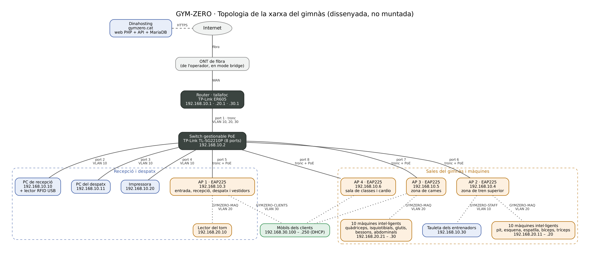

# GYM-ZERO · Disseny de la xarxa del gimnàs

**Estat: dissenyada, no muntada.** El gimnàs és fictici. La web, l'API i la base de dades sí que existeixen i són al hosting (gymzero.cat).

## 1. Què ha de connectar

| Qui | Què fa a la xarxa |
|---|---|
| PC de recepció | Rebre els clients, donar d'alta comptes, assignar polseres amb el lector RFID USB, mirar les reserves del dia |
| PC del despatx | Gestió del gimnàs: classes, activitats, usuaris i màquines. Separat de recepció perquè la gestió no es faci al taulell on s'atén el públic |
| Impressora | Imprimir horaris, rebuts i fulls d'inscripció (des dels dos PCs) |
| Tauleta dels entrenadors | A la sala de força, per mirar l'historial d'un client mentre l'entrena |
| Màquines intel·ligents (20) | Envien cada sèrie a l'API de gymzero.cat per HTTPS |
| Torn d'entrada a les sales | Pregunta a l'API de gymzero.cat si una polsera pot passar |
| Mòbils dels clients | Wifi per als clients: reservar classes i mirar el seu entrenament |

Els PCs i la tauleta fan servir la mateixa web que els clients, amb un compte d'administrador. No cal cap programa instal·lat a part del navegador.

**No hi ha cap servidor al gimnàs.** La web, l'API i la base de dades són a Dinahosting. Així el gimnàs no ha de mantenir cap servidor, i la web funciona igual des de casa que des del gimnàs. A dins només calen la xarxa i els equips que s'hi connecten.

## 2. Topologia

Les línies contínues són cable (Ethernet) i les de punts, wifi.

## 3. Equips

| Equip | Model | Per a què | Preu orientatiu |
|---|---|---|---|
| ONT de fibra | La de l'operador | Connexió a Internet | (de l'operador) |
| Router i tallafoc | TP-Link ER605 | Separa les xarxes (VLAN), fa de DHCP i decideix qui pot parlar amb qui | 60 € |
| Switch | TP-Link TL-SG2210P (8 ports, gestionable, PoE) | Connecta els equips i dona corrent als punts d'accés pel mateix cable | 100 € |
| Punts d'accés wifi (4) | TP-Link EAP225 | Un a recepció, dos a la sala de força (20 màquines repartides en dues zones) i un a la sala de classes. Cada xarxa wifi va a la seva VLAN | 4 × 70 € |
| PCs (2) | PC de sobretaula senzill amb Ubuntu | Recepció i despatx | 2 × 450 € |
| Impressora | Multifunció làser amb xarxa | Imprimir i escanejar | 150 € |
| Tauleta | Tauleta Android de 10" | Entrenadors a la sala | 180 € |
| Lector RFID USB | Lector 13,56 MHz que fa de teclat | Llegir el codi de les polseres | 12 € |
| Armari, cables i preses | Cable de categoria 6 | Instal·lació | 80 € |
| **Total** | | | **≈ 1.760 €** |

A més, 20 màquines intel·ligents a uns 59 € d'electrònica cadascuna (vegeu el disseny de la màquina): ≈ 1.180 €. I el torn d'entrada a les sales amb la porta de pas ample (vegeu el disseny del control d'accés): ≈ 1.056 €.

Els preus són orientatius. No s'ha comprat res.

## 4. Xarxes separades (VLAN)

Cada tipus d'equip va en una xarxa diferent. Si un mòbil d'un client té un virus, no pot arribar ni al PC de recepció ni a les màquines.

| VLAN | Nom | Xarxa | Porta d'enllaç | Qui hi ha |
|---|---|---|---|---|
| 10 | Gestió | 192.168.10.0/24 | 192.168.10.1 | Router, switch, punts d'accés, PCs, impressora i tauleta |
| 20 | Màquines | 192.168.20.0/24 | 192.168.20.1 | Les màquines intel·ligents i el lector del torn |
| 30 | Clients | 192.168.30.0/24 | 192.168.30.1 | Mòbils dels clients |

## 5. Adreces IP

| Equip | IP | Com |
|---|---|---|
| Router (VLAN 10 / 20 / 30) | 192.168.10.1 / 192.168.20.1 / 192.168.30.1 | Fixa |
| Switch | 192.168.10.2 | Fixa |
| AP 1 (recepció) | 192.168.10.3 | Fixa |
| AP 2 (sala de força, tren superior) | 192.168.10.4 | Fixa |
| AP 3 (sala de força, zona de cames) | 192.168.10.5 | Fixa |
| AP 4 (sala de classes) | 192.168.10.6 | Fixa |
| PC de recepció | 192.168.10.10 | Reserva DHCP |
| PC del despatx | 192.168.10.11 | Reserva DHCP |
| Impressora | 192.168.10.20 | Fixa |
| Tauleta dels entrenadors | 192.168.10.30 | Reserva DHCP |
| Lector del torn d'entrada a les sales | 192.168.20.10 | Reserva DHCP (per MAC) |
| Màquines intel·ligents | 192.168.20.11 a 192.168.20.30 (taula de sota) | Reserva DHCP (per MAC) |
| Lliures per a més màquines | 192.168.20.31 a 192.168.20.99 | |
| Mòbils dels clients | 192.168.30.100 a 192.168.30.250 | DHCP |

El lector i les màquines tenen sempre la mateixa IP perquè, si una falla, a la llista del router es veu de seguida quina és.

### Màquines intel·ligents

Dues per cada grup muscular. Totes 20 són a la base de dades de proves (`bd/dades_prova.sql`), amb la clau de prova `token-<CODI>`, i es poden fer servir amb el simulador. PRESS-01, SQUAT-01 i REM-01 mantenen el codi que tenien.

| Grup muscular | Codi | Màquina | IP | AP |
|---|---|---|---|---|
| Pit | PRESS-01 | Press de banca | 192.168.20.11 | 2 |
| Pit | CONTR-01 | Contractora de pit | 192.168.20.12 | 2 |
| Esquena | REM-01 | Rem assegut | 192.168.20.13 | 2 |
| Esquena | JALO-01 | Jaló al pit | 192.168.20.14 | 2 |
| Espatlla | MILITAR-01 | Press militar en màquina | 192.168.20.15 | 2 |
| Espatlla | LATERAL-01 | Elevacions laterals en màquina | 192.168.20.16 | 2 |
| Bíceps | CURL-01 | Curl de bíceps en màquina | 192.168.20.17 | 2 |
| Bíceps | CURLP-01 | Curl de bíceps en politja | 192.168.20.18 | 2 |
| Tríceps | TRICEP-01 | Extensió de tríceps en màquina | 192.168.20.19 | 2 |
| Tríceps | FONS-01 | Fons en màquina | 192.168.20.20 | 2 |
| Quàdriceps | SQUAT-01 | Rack de sentadilla | 192.168.20.21 | 3 |
| Quàdriceps | EXTQ-01 | Extensió de quàdriceps | 192.168.20.22 | 3 |
| Isquiotibials | FEMS-01 | Curl femoral assegut | 192.168.20.23 | 3 |
| Isquiotibials | FEME-01 | Curl femoral estirat | 192.168.20.24 | 3 |
| Glutis | HIP-01 | Hip thrust en màquina | 192.168.20.25 | 3 |
| Glutis | ABDUC-01 | Abductora | 192.168.20.26 | 3 |
| Bessons | TALOD-01 | Elevació de talons dempeus | 192.168.20.27 | 3 |
| Bessons | TALOA-01 | Elevació de talons asseguda | 192.168.20.28 | 3 |
| Abdominals | CRUNCH-01 | Crunch en màquina | 192.168.20.29 | 3 |
| Abdominals | ROTA-01 | Rotació de tronc | 192.168.20.30 | 3 |

## 6. Xarxes wifi

| Nom (SSID) | VLAN | Seguretat | Notes |
|---|---|---|---|
| GYMZERO-MAQ | 20 | WPA2-PSK, contrasenya llarga que només té l'administrador | Només 2,4 GHz (l'ESP32 no fa servir 5 GHz). L'emeten l'AP 2 i l'AP 3 (10 màquines cadascun) i l'AP 1 (el lector del torn) |
| GYMZERO-STAFF | 10 | WPA2-PSK, contrasenya del personal | Per a la tauleta dels entrenadors. L'emeten els quatre AP |
| GYMZERO-CLIENTS | 30 | WPA2-PSK, contrasenya penjada a recepció | Aïllament de clients: un mòbil no veu els altres. Límit de 10 Mbps per mòbil |

Els PCs i la impressora van per cable.

### On va cada punt d'accés

Els AP van al sostre. La posició surt de la maqueta 3D del gimnàs (`gimnas/`), comptant que cada AP cobreix uns 11 m al voltant. Amb aquesta posició no queda cap racó sense wifi.

| AP | On és | Cobreix |
|---|---|---|
| AP 1 | Sobre el taulell de recepció | Entrada, recepció, despatx, vestidors i part del cardio |
| AP 2 | Sala de força, entre les màquines de pit i d'esquena | Tren superior i vestidor 1 |
| AP 3 | Sala de força, entre les màquines de glutis i de bessons | Cames, abdominals i pes lliure |
| AP 4 | Al mig de la sala de classes | Sala de classes, cardio i pes lliure |

## 7. Ports del switch

| Port | Connectat a | Mode |
|---|---|---|
| 1 | Router | Tronc: VLAN 10, 20 i 30 |
| 2 | PC de recepció | Accés: VLAN 10 |
| 3 | PC del despatx | Accés: VLAN 10 |
| 4 | Impressora | Accés: VLAN 10 |
| 5 | AP 1 (recepció) | Tronc: VLAN 10, 20 i 30, amb PoE |
| 6 | AP 2 (tren superior) | Tronc: VLAN 10, 20 i 30, amb PoE |
| 7 | AP 3 (cames) | Tronc: VLAN 10, 20 i 30, amb PoE |
| 8 | AP 4 (sala de classes) | Tronc: VLAN 10 i 30, amb PoE |

## 8. Regles del tallafoc

El router només deixa passar el que cal. Tot el que no és a la taula està prohibit.

| Des de | Cap a | Permès |
|---|---|---|
| Gestió (10) | Internet | Tot |
| Gestió (10) | Màquines (20) | Sí, per comprovar si una màquina respon |
| Màquines (20), també el lector del torn | Internet | Només HTTPS (port 443) a gymzero.cat, DNS (53) i hora (NTP, 123) |
| Màquines (20) | Gestió (10) i Clients (30) | No |
| Clients (30) | Internet | Web (80, 443) i DNS (53) |
| Clients (30) | Gestió (10) i Màquines (20) | No |
| Internet | Qualsevol VLAN | No (només les respostes del que s'ha demanat des de dins) |

## 9. Com viatja una sèrie

1. El client acaba una sèrie a PRESS-01 (192.168.20.11).
2. La màquina envia el JSON per la wifi GYMZERO-MAQ a l'AP 2.
3. L'AP 2 el passa al switch etiquetat amb la VLAN 20, i el switch el passa al router.
4. El router comprova que és HTTPS cap a gymzero.cat (permès), hi aplica NAT i l'envia a Internet.
5. El servidor de Dinahosting (`api/serie.php`) la guarda a la base de dades i respon.
6. La resposta fa el camí al revés fins a la pantalla de la màquina.

## 10. Seguretat

- Les tres xarxes estan separades i el tallafoc no deixa passar d'una a l'altra.
- Les màquines només poden parlar amb gymzero.cat. Encara que algú n'obrís una, no podria fer servir la connexió per a res més.
- Les contrasenyes de les wifi són diferents. La de les màquines no la té cap client.
- El panell del router, del switch i dels AP només s'obre des del PC del despatx (192.168.10.11).
- Tot el que va a la web viatja per HTTPS.

## 11. Limitacions

- Si cau la fibra, les màquines no poden enviar les sèries. Les guarden i les envien quan torna la connexió (vegeu el disseny de la màquina).
- Els 11 m de cobertura de cada AP són una estimació. Les parets i les màquines de ferro la redueixen; abans de muntar-ho caldria fer un estudi de cobertura amb el plànol real.
- El switch té 8 ports i ja els fa servir tots. Si calen més equips per cable, s'hauria de canviar per un de 16.
- No s'ha muntat ni configurat cap equip. Els models són exemples de material que fa el que demana el disseny (VLAN, PoE, diverses wifi).
